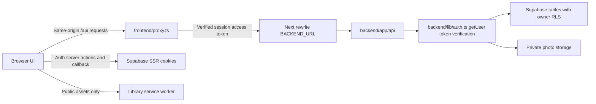

# Architecture and source map

## Request boundary

Frontend middleware entry is named `proxy.ts` in this Next version. It removes incoming Authorization, validates SSR user, forwards the current access token for API requests, refreshes cookies, and returns private/no-store responses. `next.config.mjs` rewrites `/api/:path*` to backend. There are no frontend `app/api` route handlers for these services.

Backend independently verifies Bearer tokens with Supabase `auth.getUser(token)`. User ID is derived from that verified result, never trusted from request data. The Supabase client carries the user's token; RLS is another authorization layer. The public key is sufficient for normal app APIs. Do not replace these clients with an unrestricted service-role client.

## UI source map

| Files | Responsibility |
| --- | --- |
| `frontend/app/page.tsx` | Auth/onboarding gate and account props to dashboard |
| `frontend/components/dashboard.tsx` | Shell, section state, Home, PlansWorkspace, Social, Settings, footer |
| `frontend/components/auth-screen.tsx`, `frontend/app/auth/actions.ts` | Shared auth form UI and server mutations |
| `frontend/lib/auth/*` | Server clients, validation, localhost tester, tester onboarding |
| `frontend/components/onboarding.tsx`, `body-focus-map.tsx` | Preferences wizard and highlighted body areas |
| `frontend/app/onboarding/actions.ts` | Validate and save onboarding metadata |
| `frontend/components/app-opening.tsx`, `plan-preparation.tsx` | Opening overlay and post-intake animation |
| `frontend/components/my-plan-workspace.tsx` | Targets, selected week/day, task generation/import/editing/water |
| `frontend/components/playlist-manager.tsx` | Workout/nutrition collection and manual schedule editor |
| `frontend/components/exercise-library.tsx`, `food-library.tsx` | Reference cards, filters, pagination, detail dialogs |
| `frontend/components/nutrition-workspace.tsx` | Nutrition tab adapter |
| `frontend/components/food-art.tsx` | Code-native food illustrations |
| `frontend/components/plan-time-input.tsx` | Editable time field with native picker behavior |
| `frontend/components/progress-workspace.tsx` | Three Progress tabs and journal/photo/goal actions |
| `frontend/components/plan-signout.tsx` | Pending private data signout dialog |
| `frontend/components/coach-chat.tsx` | Streaming chat client |
| `frontend/components/wordmark.tsx` | Shared FitSync branding; reuse rather than restyling text individually |

## Shared domain modules

- `shared/onboarding.ts`: allowed values, compatibility, parsing/validation, versioned profile types.
- `shared/playlists.ts`: workout/food item types, full day labels, times, portions, canonical catalog IDs, manual template validation.
- `shared/daily-plans.ts`: weekly document parsing, targets, eligible catalog selection, deterministic formulation, phase ordering, time and nutrition totals.
- `shared/exercise-query.ts`: client catalog search/filter/sort logic.
- `shared/progress.ts`: progress payload validation, local dates, streaks, completion aggregation, milestone thresholds, weight trend forecast.
- `shared/deployment.mjs`: origin validation and build-time deployment checks. Never logs variable values.

Data imports from outside a workspace are intentional. Both Next configs trace the repository root; Vercel must allow outside-root source files.

## Client state and synchronization

- `frontend/lib/planning-profile.tsx`: profile context; `fitsync-profile-updated` event updates target weight without requiring a dashboard reload.
- `frontend/lib/playlist-account.tsx`: owner context, visits, prefetch, reconnect listeners, auth cleanup.
- `frontend/lib/playlists.ts` + `playlist-offline.ts`: remote CRUD, account-partitioned IndexedDB, optimistic sync, tombstones/conflicts.
- `frontend/lib/daily-plans.ts`: account/week localStorage copies, revisions, pending writes, sync and conflict handling.
- `frontend/lib/progress.ts`: account snapshots, pending visits, private APIs, photo preprocessing; merges plan copies for display.
- `frontend/lib/playlist-navigation.tsx`: editor navigation guard shared with shell/mode/tab switches.
- `frontend/lib/plan-signout.ts`: pending plan/playlist/visit detection, sync-before-logout and cleanup.
- `frontend/lib/exercise-offline.ts` + `components/offline-library-status.tsx`: public download state and readiness.

## Styling map

Global imports are in `frontend/app/layout.tsx`; feature components may also import CSS. Inspect cascade order before adding overrides. Many legacy styles are dense/minified handwritten CSS.

- `globals.css`, `theme.css`: base styles, palette, dashboard/legacy styles.
- `home.css`, `home-responsive.css`, `hero-responsive.css`, `responsive.css`: hero and cross-screen adjustments. Later rules can override earlier layouts.
- `auth.css`, `auth-mobile.css`: desktop/mobile auth; breakpoint is below 768 px mobile, 768 px and up desktop.
- `opening.css`, `onboarding/onboarding.css`, `plan-preparation/preparation.css`: entry flows.
- `playlists.css`, `my-plan.css`: private plan/playlist editors.
- `exercise-library.css`, `food-library.css`: public references.
- `progress.css`: tab layout, charts, cards, journal, photos, awards, editor.
- `day-selector.css`, `schedule.css`: older plan schedule design; inspect whether current component actually uses a rule before editing it.
- `footer.css`, `coach-chat.css`: shared footer and chat.

## Assets and generated artifacts

Mascots: `frontend/public/mascot/`. Important files include `fox-logo.png`, `fox-opening.jpg`, `fox-greeting.png`, `fox-plan-workout.png`, `fox-plan-nutrition.png`, `fox-social-phone.png`, `social-connected-earth.png`, and auth mascot variants. Inspect actual use before deleting an image.

Exercise assets: `frontend/public/exercises/<id>.gif` and static `<id>.webp`. Public offline catalogs/manifests under `frontend/public/offline/`. There is also `frontend/offline/`; inspect seed script outputs before hand-editing generated files.

`backend/data/exercises.json`, `foods.json`, food source subset, curation scripts and import scripts are related. Regenerate through scripts; changing only a generated public copy will be overwritten. Catalog ID changes also require regenerating the SQL allowlist.

`logs/`, `.next/`, `node_modules/`, `.env.local` are local/generated/private and not durable project documentation. Some previous browser tests exist only in ignored logs; committed validation scripts are the reproducible baseline.
