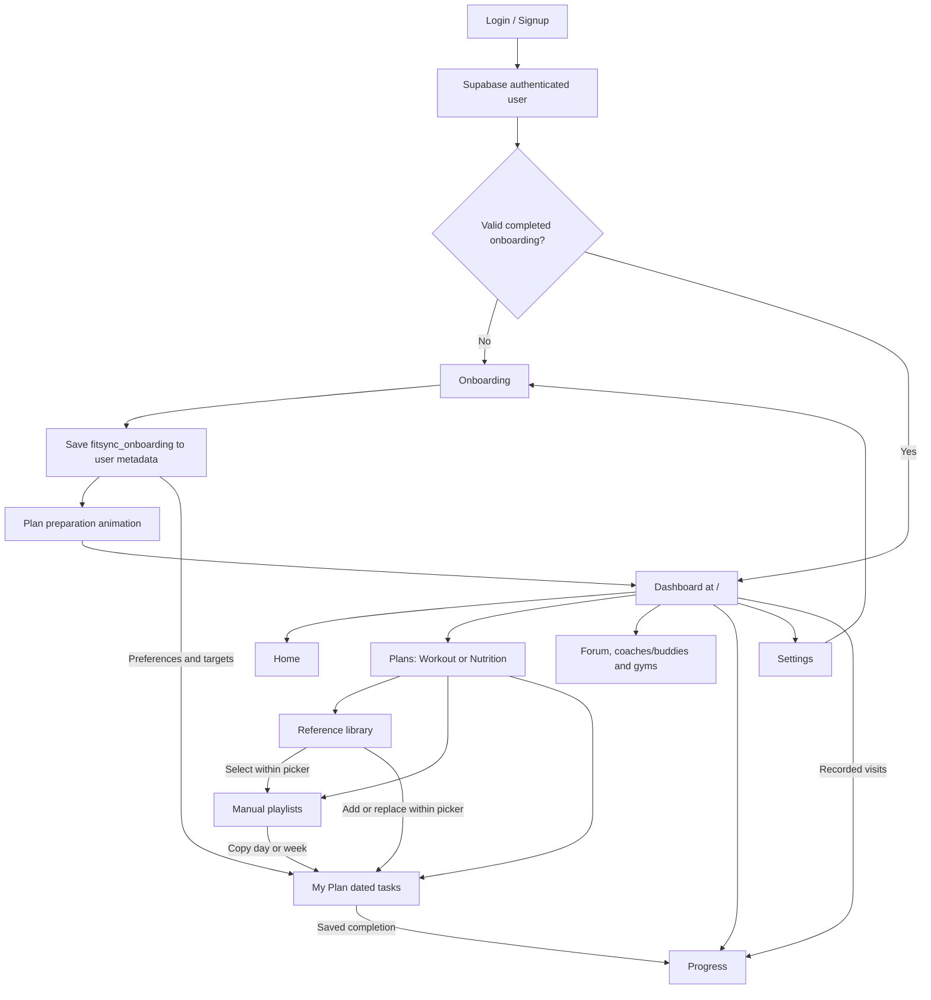

# Features and page relationships

## Routes versus dashboard sections

The dashboard is rendered at `/`. Home, Plans, Social, Progress, Settings, and the library shortcut are React section state inside `frontend/components/dashboard.tsx`; they are **not** independent `/plans`, `/social`, or `/progress` routes. Avoid inventing deep links that do not exist.

| Route | Purpose |
| --- | --- |
| `/login`, `/signup` | Email/password and Google sign-in/sign-up |
| `/forgot-password`, `/reset-password` | Password recovery and update |
| `/auth/callback` | OAuth code exchange, session cookies, safe next-page redirect |
| `/auth/confirm` | Email confirmation flow |
| `/onboarding` | Authenticated five-step preferences, also reopened from Settings |
| `/plan-preparation` | Authenticated setup animation after onboarding |
| `/` | Authenticated dashboard; completed onboarding required |
| `/offline-library` | Compatibility redirect to `/`, not a second library |

## Authentication and onboarding

Real auth uses Supabase; Google is handled through Supabase's Google provider. Form fields, validation, show-password controls, password recovery, server actions, and session protection are implemented. Google action is placed after the password/sign-in area. Browser public keys are allowed; secrets are not.

Onboarding is separate from auth. It collects:

- Goal: general fitness, fat loss, muscle gain, strength, endurance, or mobility (canonical values in `shared/onboarding.ts`).
- Primary focus: Overall OR multiple Chest/Back/Legs/Shoulders/Arms/Core/Cardio choices, with body highlighting UI.
- Exact age 1-120, gender, IANA time zone, activity, optional height/current weight/target weight.
- Training weekdays, session duration, experience, equipment, movement preferences.
- Diet, reviewed allergens and Other allergy text, dislikes, meals/day, cooking time, budget.
- Review before saving.

Real profiles are versioned `fitsync_onboarding` JSON in Auth user metadata. Draft answers live in component memory and are lost on refresh. Version-1 profiles have compatibility handling. Gender is not assumed to be biological sex. Under-18 onboarding is allowed, but adult calorie/weight-change calculations and weight forecasts remain age restricted. The retired professional-guidance movement option is ignored on legacy input; do not reintroduce it as a blanket workout-generation block.

`/plan-preparation` is a timed animation, not a background generation job. It lasts about 5.4 visible seconds and pauses while hidden or the app opening overlay is present. Its text still contains an outdated statement that generation will be connected next; see backlog.

## Shared dashboard shell

Header: hamburger, fox logo and FitSync wordmark, search affordance, account button. Hamburger opens left navigation. Bottom navigation has Home, Plans, a central raised Play button, Social, and Progress. Play opens Plans > Playlist. Bottom navigation hides on downward scroll. Footer links navigate existing sections; contact is marked coming soon, not a real contact page.

`PlaylistNavigationProvider` guards navigation while editing an unsaved playlist. `PlanningProfileProvider` distributes validated onboarding and accepts target-weight profile update events. `PlaylistAccountProvider` distributes real user ID, preloads playlist collections, records visits, and handles signout cleanup.

## Plans: two modes, three tabs

Workout/Nutrition changes **all** content beneath the shared hero:

| Tab | Workout | Nutrition |
| --- | --- | --- |
| My plan | Exercise schedule and time/sets/reps targets | Food schedule and energy/macronutrient targets |
| Playlist | Manual exercise templates | Manual food templates |
| Library | 100-exercise reference | 100-food reference |

Hero switches dumbbell/apple mascot with mode. Folder-style navigation is intentional. Changing mode can invoke the unsaved editor guard. Folder selection is component state; not a URL.

### Libraries

Exercise: paginated 24-card grid, query/filter counts, muscle/focus/equipment/category/difficulty/movement filters, multi-equipment choices, aliases, sorting, full details. Static WebP thumbnails stay still; GIF plays only when demonstration is explicitly started. Specific instructions, read-more behavior, coach tips, metadata and informational estimates are included.

Food: paginated 24-card grid, search aliases (including common Filipino food names), category/classification filters, eating preference and optional matching preferences, source preparation states, allergens, benefit explanations, nutrients and gram-backed household portions. Food details have an informational amount calculator. Missing source values remain unknown rather than fabricated.

Both libraries are seeded references, independent of onboarding defaults. Personal amounts and selection belong to plan/playlist editors. Library dialogs are reused in pickers and on already-added items. Foods are generic ingredients, not branded products or complete recipes.

### Playlists

One create button per collection. Search and compact day/week filter sit together. A playlist has name, optional description, kind, one-day/full-week duration, selected day, scheduled entries, workout rest days, and revision. Full weekday names are shown.

Editor uses compact schedule rows: time, choose item, and workout target or food grams/meal. A new blank row lets users keep adding. Entries can be removed in both durations. Workout rest days cannot contain exercises; **nutrition never has rest days**. Details are available before and after selection.

Save persists the device copy, attempts database sync, and exits to the collection on success; pending is distinguishable from uploaded. Back to playlists discards an unsaved editor draft, with existing navigation protection. Do not reintroduce separate confusing Cancel/All playlists controls. Copying is supported in existing saved/conflict workflows; inspect current controls before changing them.

Importing a playlist into My Plan copies items; it does not link or mutate the original template. A one-day template maps its source day to the selected schedule day. A week template replaces seven days for the selected mode only; water and the other mode survive. Completion resets.

### My Plan

Four functional groups: target/completed totals, Monday-Sunday selection, daily to-dos, and eight scheduled water glasses. Week is Monday-start in the saved time zone. Workout and nutrition are separate schedules; water is shared for the same day.

Three ways to populate tasks:

1. Formulate/regenerate the selected day using shared calculations and onboarding.
2. Import a day/week playlist.
3. Choose additional/replacement library items manually.

Single-item alternatives run the shared engine too. Regeneration/import warns before replacing populated tasks. Tasks have details, thumbnail, editable native time, quantities/targets, completion, and deletion. Picker opening scrolls/focuses the replacement form. Editing task quantities resets its completion.

Workouts have movement phases, warm-up/cooldown guidance, between-set rest, and optional actual-set logs separate from planned targets. Nutrition groups ingredients by meal and time, calculates real portion totals, and offers mark/undo whole meal. Rest applies only to workouts, initially derived from training weekdays or imported template. Manual exercise addition clears that day's rest flag.

Default water goal: eight 250 ml glasses, editable times and individual completion. It is an app default, not a universal medical hydration prescription.

## Progress: current three-tab organization

All tabs share real account data, overview hero, refresh, and status/error notices. Local tester shows empty data rather than fake achievements.

- **Analytics:** profile/goal and target-weight edit; completed to-dos; finished workout days; estimated monthly working minutes; latest weight; eight-week frequency; twelve-week consistency calendar; goal outlook from recorded weight trend.
- **Documentation:** Body & measurements chart and Add entry; Energy & recovery chart/check-in; editable/paginated measurement and wellness journal; private side-by-side photo timeline. The user explicitly asked that DOCUMENT YOUR OWN CHANGE and HOW YOU FEEL COUNTS TOO stay here.
- **Achievements:** unlocked count; Showing up group (visits/best streak); Getting things done group (todos/workout days); locked/unlocked milestones and progress.

Body records: weight, body fat, chest/waist/hips/arm/thigh, optional notes. Wellness: RPE, energy, mood, sleep quality, soreness, sleep hours. Photos: private upload, date/caption edit, delete and comparison. Logging weight does not automatically rewrite onboarding or regenerate plans.

Forecast uses observed weight trend only when sufficient reliable adult data exists. It cannot predict muscle gain/strength/endurance. Full thresholds are in PROGRESS_SETUP.md and `shared/progress.ts`.

## Partially implemented sections

**Home:** personalized name, design and navigation work. Date, 12-day streak, calorie/movement figures and example tasks include hardcoded data; water/completion state here is not yet the canonical My Plan data. Do not call Home fully data-driven.

**Social:** existing earth/phone mascot hero above one overview with three preview sections: Open forum, Coaches & gym buddies, Gyms & facilities. View more opens the selected section and Back to community returns to the overview. `SocialWorkspace` provides real account-backed CRUD, forum hearts, comments, own-post filters, search and pagination through `/api/social` and `community_action`. SQL enforces two new forum/gym posts per UTC day and one active introduction. Posts expire together every calendar quarter; daily backend cron purges data and queued images. GPS + Leaflet/OpenStreetMap nearby search is opt-in, with free Overpass fallback endpoints and external walking directions. Requires `20261111_social.sql`; cron needs backend-only secrets. The hero community count remains decorative legacy content. See `SOCIAL_SETUP.md`.

**Settings:** real account display, onboarding link, default theme and signout exist. Many edit/notification/offline/export/delete controls are placeholders. There is no complete account deletion workflow or real contact page.

## Home dashboard (November 10 update)

Home now renders `HomeDashboard` below the preserved hero. It reads saved daily plans, progress, playlist counts and recent Social counts. Scoped `home-dashboard.css` supplies the modular layout. `HomeDestination` opens the chosen Plans mode/tab, Progress tab or Social section; the water shortcut focuses the existing Plans tracker. Tip cards have illustrated covers and source-backed reverse text. `CoachChat` is a form/dialog using authenticated `/api/coach`, with server-side OpenRouter free-model discovery and up to five attempts. Chat is online-only and tab-local, not database-persisted. See `HOME_SETUP.md` for configuration and limitations. No new SQL migration is required.
